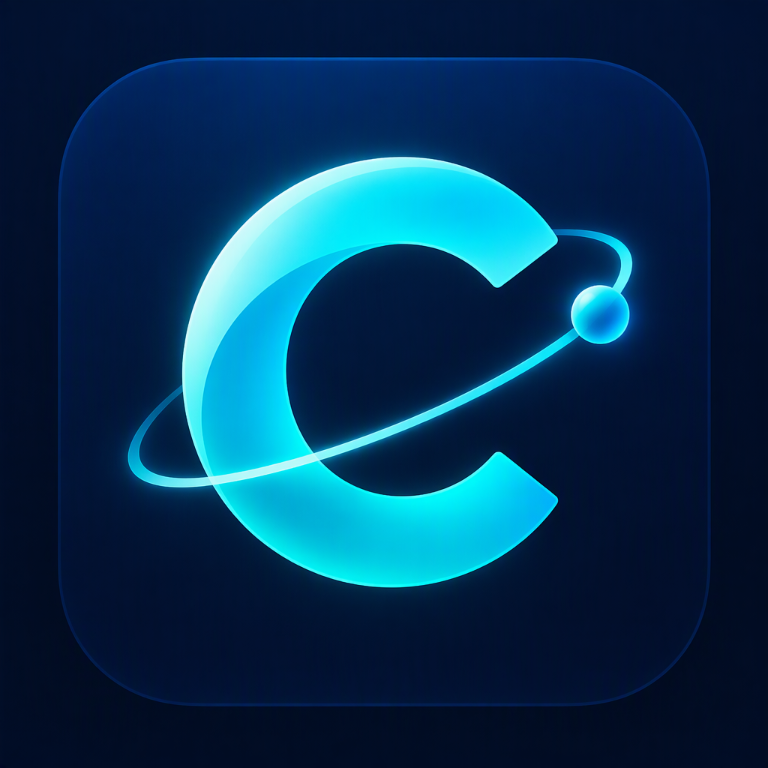

<div align="center">



# CYRUS

### Your desktop. Your commands. Your AI assistant.

A Windows desktop assistant with a cyber-style dashboard, local or online AI,
typed chat, optional voice, system tools, timers, web search, and news.

> [!IMPORTANT]
> CYRUS is currently available for **Windows only**. Android, iOS, and macOS
> versions are planned for future updates; they are not available yet.

[](https://www.microsoft.com/windows)
[](https://www.python.org/)
[](https://www.riverbankcomputing.com/software/pyqt/)
[](https://ollama.com/)
[](https://duckduckgo.com/)
[](https://github.com/aishik356/CYRUS-AI-Desktop-Assitant/releases)

**[Explore the code](https://github.com/aishik356/CYRUS-AI-Desktop-Assitant)**
· **[Download releases](https://github.com/aishik356/CYRUS-AI-Desktop-Assitant/releases)**
· **[Report a problem](https://github.com/aishik356/CYRUS-AI-Desktop-Assitant/issues)**

</div>

> [!NOTE]
> CYRUS runs as a Windows desktop app. GitHub hosts its source and downloadable
> releases; it does not host the running assistant or provide a built-in
> database of everything in the world.

## ✨ What it can do

- **Chat your way:** use the dashboard chat box, with an optional manually
  enabled microphone. The microphone starts muted; there is no always-listening
  wake word.
- **Choose an AI backend:** run `llama3.2:3b` locally through Ollama, or
  configure OpenRouter for online replies.
- **Speak and listen:** use the optional local Piper Alan voice for speech
  output and Google's online speech recognition for microphone input.
- **Find information:** search the web and current news with DuckDuckGo. CYRUS
  returns a limited set of snippets and links, not exhaustive or guaranteed
  complete coverage.
- **Control your PC:** view hardware and live resource reports, launch
  applications, adjust Windows and player volume, and use optional VLC music
  controls.
- **Stay on schedule:** create timers and reminders with dashboard countdowns.
- **Customize the dashboard:** arrange its panels and adjust its appearance.

## 🚀 Download and install

Open **[GitHub Releases](https://github.com/aishik356/CYRUS-AI-Desktop-Assitant/releases)**
and download `CYRUS-Setup.exe` when a release is available. Run the installer
to choose an install folder and optional features. No Python commands or
`requirements.txt` installation are needed for the packaged app; the installer
bundles CYRUS and its Python dependencies.

> [!IMPORTANT]
> Ollama and VLC are separate apps and are not bundled. CYRUS can offer to
> download the Ollama model during setup, but Ollama itself must already be
> installed. Windows may show an unknown-publisher warning because the
> installer is not code-signed.

The setup lets you choose these optional features:

| Feature | Notes |
| --- | --- |
| Alan voice output | Optional local voice download; review its upstream terms |
| Microphone input | Internet is required for Google's speech-recognition service; starts muted |
| Web search and news | Internet required; uses DuckDuckGo |
| VLC music controls | VLC must be installed separately |
| Screen analysis | Requires an OpenRouter API key; screenshots are sent when analysis is requested |

The local Ollama model `llama3.2:3b` is several gigabytes and is an optional,
separate download. Alternatively, configure OpenRouter with your own API key.

## 🛠️ Run from source

### Requirements

- Windows 10/11, 64-bit
- Python 3.11
- Ollama running locally for the default AI backend, or an OpenRouter API key
- VLC installed separately if you want music playback

### Install Python dependencies

Open PowerShell in the project folder:

```powershell
py -3.11 -m venv .venv
.\.venv\Scripts\Activate.ps1
python -m pip install --upgrade pip
pip install -r requirements.txt
```

If PowerShell blocks environment activation, allow it for the current terminal
and try again:

```powershell
Set-ExecutionPolicy -Scope Process -ExecutionPolicy Bypass
```

### Configure the AI backend

For local AI, [install Ollama](https://ollama.com/download) and pull CYRUS's
model:

```powershell
ollama pull llama3.2:3b
```

Keep Ollama running while using the local backend. To use OpenRouter instead,
copy `.env.example` to `.env`, add your `OPENROUTER_API_KEY`, and set
`CYRUS_AI_BACKEND=openrouter`. You can skip the Ollama model download when
using OpenRouter.

### Configure optional Alan speech

CYRUS does not bundle the Alan voice files. Download both files from the
[upstream Alan voice folder on Hugging Face](https://huggingface.co/rhasspy/piper-voices/tree/main/en/en_GB/alan/medium):

- [Download the Alan ONNX model](https://huggingface.co/rhasspy/piper-voices/resolve/main/en/en_GB/alan/medium/en_GB-alan-medium.onnx?download=true)
- [Download its voice configuration](https://huggingface.co/rhasspy/piper-voices/resolve/main/en/en_GB/alan/medium/en_GB-alan-medium.onnx.json?download=true)

Save both files, with their original names, in the project's `voices` folder:

```text
CYRUS/
└── voices/
    ├── en_GB-alan-medium.onnx
    └── en_GB-alan-medium.onnx.json
```

The installer provides an optional download too. For an installed copy, save
the files in `%LOCALAPPDATA%\CYRUS\voices\` instead, then restart CYRUS. The
model card points to a source marked **All Rights Reserved**; review the
[upstream model card and terms](https://huggingface.co/rhasspy/piper-voices/tree/main/en/en_GB/alan/medium)
before downloading or using the voice.

### Start CYRUS

```powershell
python main.py
```

CYRUS performs startup checks and warns about unavailable features without
preventing the dashboard from opening. The microphone remains muted until you
enable it using the dashboard control or F3/Ctrl+M.

## 🔨 Build the Windows installer

Set up the Python build environment with the project requirements and
`requirements-build.txt`, and install [Inno Setup 6](https://jrsoftware.org/isinfo.php):

```powershell
py -3.11 -m venv .venv
.\.venv\Scripts\python.exe -m pip install -r requirements-build.txt
.\build_windows.ps1
```

Build outputs:

- Portable folder: `dist\CYRUS\` (keep the entire folder together)
- Installer: `dist\installer\CYRUS-Setup.exe`

The installer requests administrator approval through UAC and offers a custom
install location, optional features, and a desktop shortcut. It can optionally
download the Ollama model and Alan voice files after installation; neither
download is required to build the installer.

## 🌦️ Search, weather, and media

- Ask for current conditions by city, or a seven-day forecast. Named-location
  weather uses Open-Meteo. If no city is specified, CYRUS estimates your
  location using your public IP.
- Ask for news or current events to get live DuckDuckGo news results; use
  `search for ...` for general web results. Search is not a guarantee of
  complete or exhaustive answers.
- Open supported applications and websites with chat or voice commands.
- Ask CYRUS to search YouTube for music and manage the queue. VLC must be
  installed for the local player integration.
- Set timers and reminders using natural-language requests.

## 🔊 Audio controls

- **VOICE** changes CYRUS's Piper speech loudness.
- **SYSTEM** changes the Windows master volume and tracks external Windows
  volume changes.
- **PLAYER** changes VLC music playback independently.

The slider values are saved for the current user. Existing typed and voice
volume commands remain available.

## 🔐 Privacy and network use

- Typed conversations use Ollama locally by default. If OpenRouter is selected,
  prompts and the memory context included with them are sent online.
- When enabled, microphone speech is sent to Google's online
  speech-recognition service. The microphone starts muted.
- A screen-analysis request sends a screenshot to OpenRouter.
- Web/news queries go to DuckDuckGo. Weather uses Open-Meteo and IP-based
  geolocation when no location is given.
- Alan speech synthesis is local once the model files have been downloaded.
- Personal API keys, `.env`, local memory, build outputs, and downloaded voice
  models are excluded from Git. **Never commit credentials or personal data.**

Use voice and screen-analysis features with sensitive information only if
you're comfortable with these data flows. Offline mode disables online AI,
search, weather, websites, YouTube playback, screen analysis, and cloud speech
input while retaining local system tools, reminders, and local Ollama chat.

## 🧩 Technology

<p>
  <a href="https://www.python.org/"></a>
  <a href="https://www.riverbankcomputing.com/software/pyqt/"></a>
  <a href="https://ollama.com/"></a>
  <a href="https://github.com/rhasspy/piper"></a>
  <a href="https://duckduckgo.com/"></a>
  <a href="https://pyinstaller.org/"></a>
</p>

## 🤝 Contributing

Bug reports and suggestions are welcome through
[GitHub Issues](https://github.com/aishik356/CYRUS-AI-Desktop-Assitant/issues).
Please don't include API keys, personal memory, or sensitive screenshots in
issues.

## 📄 License and third-party assets

No project license has been specified yet; all rights are reserved by default.
The optional Alan voice has separate upstream terms. Review the licenses of
third-party dependencies and assets before redistribution.
